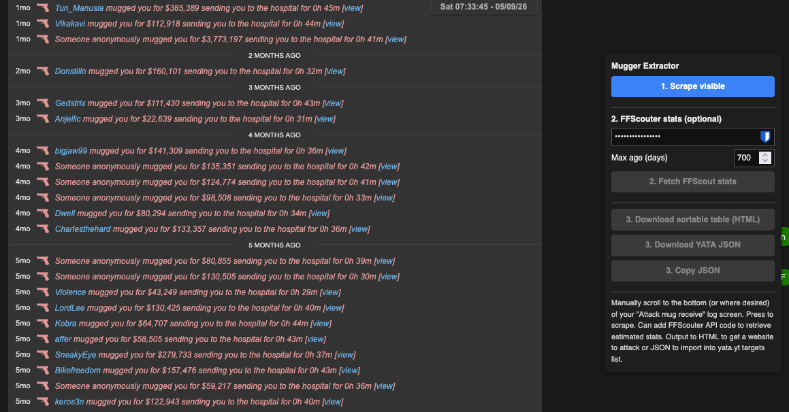
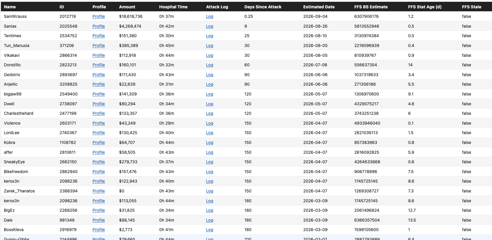
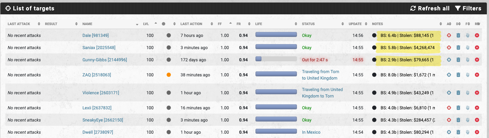

# Torn Mugger Extractor

Here is a tampermonkey userscript that scrapes your Torn "Attack / Mug received" log
for who's been mugging you. It optionally includes stat estimates with the help of [FFScouter](https://ffscouter.com). Exports either HTML target list that is sortable. Or a JSON file ready for you to add to [yata.yt](yata.yt) targets list.

**Author:** a1ry [3583932]

**Notes:** I have only tested this on desktop and Firefox, but I imagine it is functional on desktop. It may be functional on mobile phones through e.g. Firefox, but the interface will be bulky. I doubt you want to run this on TornPDA. 

**Screenshots:**

Plugin interface:
 

HTML targets list:

YATA export: the YATA export also puts the battlestats and mug amounts into the Notes column:

## Install

1. Install [Tampermonkey](https://www.tampermonkey.net/).
2. Open `torn-mugger-extract.user.js` in this repo → click **Raw** → Tampermonkey
   picks it up and prompts to install.
3. Updates: Tampermonkey checks this repo automatically (via `@updateURL`), or
   trigger it manually from the Tampermonkey dashboard → **Utilities → Check
   for userscript updates**.

## Use

1. Go to your [Attack / Mug received log](https://www.torn.com/page.php?sid=log&log=8156)
   (the panel will offer a shortcut button if you're on the wrong page).
2. Scroll to however far back you want, then click **1. Scrape visible**.
3. Optionally enter an [FFScouter](https://ffscouter.com) API key and click
   **2. Fetch FFScout stats** to attach battlestat estimates.
4. Export:
   - **Download sortable table (HTML)** — a standalone page you can open and
     click column headers to sort.
   - **Download YATA JSON** — import straight into your [yata.yt](https://yata.yt)
     targets list.
   - **Copy JSON** — raw data for anything else.

Anonymous ("Someone anonymously mugged you") entries can't be attacked back,
so they're excluded from the table and only shown as a count/total tally.
